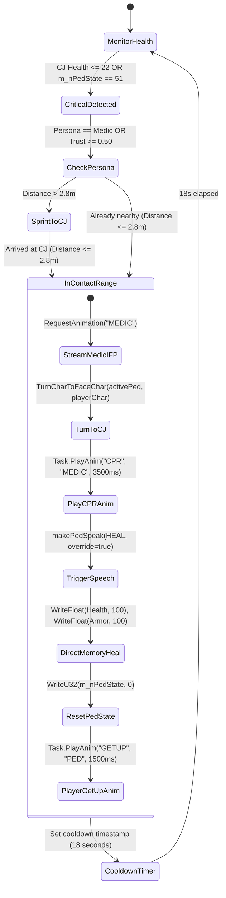

# GTA San Andreas AI Companion - Engine Internals & Reverse Engineering Specifications

> **Target Audience**: Reverse engineers, game developers, AI systems architects, and mod developers.
> **Scope**: RenderWare memory layout, object pools, calling conventions, assembly signatures, 16-D semantic vector matching, Line-of-Sight raycasting physics, and engine-level audio state tracking.

---

## 1. RenderWare Memory Layout & Hardware Object Pools

GTA San Andreas maintains game entities inside dedicated, contiguous memory pools managed by the game engine (`CPool`). The companion script accesses these pools directly without hooking runtime hooks or modifying executable code on disk.

```
                     +---------------------------------------+
                     |       CWorld / Engine Memory          |
                     +---------------------------------------+
                                         |
            +----------------------------+----------------------------+
            |                                                         |
            v                                                         v
   CPedPool (0x00B74490)                                     CVehiclePool (0x00B74494)
+-----------------------------+                           +-----------------------------+
| *poolPtr                    |                           | *poolPtr                    |
|   +0x00: objectsArray (Ptr) |                           |   +0x00: objectsArray (Ptr) |
|   +0x04: byteMap (Ptr)      |                           |   +0x04: byteMap (Ptr)      |
|   +0x08: maxElements (140)  |                           |   +0x08: maxElements (110)  |
+-----------------------------+                           +-----------------------------+
            |                                                         |
            v                                                         v
  Array of CPed instances                                   Array of CVehicle instances
  Slot Size: 0x7C4 (1,988 B)                                Slot Size: 0xA18 (2,584 B)
```

### 1.1 Pool Pointer Dereferencing & Slot Validation Algorithm

When CLEO Redux receives an entity handle (e.g. `charHandle` or `carHandle`), it is not a raw memory address. It is an index/generation pair encoded into a 32-bit integer:

$$\text{Slot Index} = \text{handle} \gg 8$$
$$\text{Handle Generation} = \text{handle} \ \& \ \text{0x7F}$$

```javascript
function getPedPointer(entity) {
    let handle = getHandle(entity);
    if (!handle || typeof handle !== "number") return 0;
    try {
        let poolPtr = Memory.ReadU32(ADDR_PED_POOL, false);
        if (!poolPtr) return 0;
        let objectsArray = Memory.ReadU32(poolPtr, false);
        let byteMap = Memory.ReadU32(poolPtr + 4, false);
        let slot = handle >> 8;
        if (slot < 0 || slot >= 140) return 0;
        
        let flag = Memory.ReadU8(byteMap + slot, false);
        // Bit 7 (0x80) indicates whether slot is free/empty
        if (flag & 0x80) return 0;
        // Bits 0..6 verify generation match to prevent stale pointer aliasing
        if ((flag & 0x7F) !== (handle & 0x7F)) return 0;
        
        // Exact hardware pointer calculation
        return objectsArray + (slot * 0x7C4);
    } catch (_) {
        return 0;
    }
}
```

### 1.2 `CPed` Struct Layout & Offsets (Slot Size: `0x7C4` / 1,988 bytes)

| Offset (Hex) | Type | Field Name | Description | Used By Companion Subsystem |
| :--- | :--- | :--- | :--- | :--- |
| `+0x000` | `void**` | `vtable` | CPhysical / CPed Virtual Method Table | Native object polymorphism |
| `+0x014` | `CMatrix*` | `m_pMatrix` | 3D transformation matrix (position, rotation) | Spatial coordinate mapping |
| `+0x32E` | `uint8` | `m_pedAudio.bIsTalking` | Audio state flag (`0` = idle, `1` = speaking) | Zero-latency speech tracking |
| `+0x47C` | `CPedIntelligence*`| `m_pIntelligence` | Pointer to AI decision tree & decision tables | Threat & situational analysis |
| `+0x47C + 0x70` | `uint32` | `threatCount` | Count of active hostiles recognized by entity | Threat priority routing |
| `+0x530` | `uint32` | `m_nPedState` | Finite state machine enum (`ePedState`) | Critical condition & dying triage |
| `+0x540` | `float` | `m_fHealth` | Current health points ($0.0$ to $100.0+$) | Auto-heal & medical resuscitation |
| `+0x548` | `float` | `m_fArmor` | Current body armor points ($0.0$ to $100.0$) | Tactical gear & armor injection |
| `+0x58C` | `CVehicle*` | `m_pVehicle` | Pointer to current vehicle ped is seated in | Auto-drive-by, embark/disembark |
| `+0x784` | `CEntity*` | `m_pTargetedObject` | Pointer to object/ped currently locked or aimed | Combat suppression & target sync |

#### Key Values of `m_nPedState` (Enum `ePedState`):
* `0`: `PEDSTATE_NONE` (Normal idle/wandering)
* `1`: `PEDSTATE_IDLE` (Standing in place)
* `7`: `PEDSTATE_ATTACK` (Actively firing or meleeing target)
* `50`: `PEDSTATE_DEAD` (Dead, collision cleared)
* `51`: `PEDSTATE_DIE` (Incapacitated / wounded dying animation, prior to Wasted screen)

### 1.3 `CVehicle` Struct Layout & Offsets (Slot Size: `0xA18` / 2,584 bytes)

| Offset (Hex) | Type | Field Name | Description | Used By Companion Subsystem |
| :--- | :--- | :--- | :--- | :--- |
| `+0x000` | `void**` | `vtable` | CVehicle Virtual Method Table | Entity validation |
| `+0x4C0` | `float` | `m_fHealth` | Vehicle structural integrity (1000 = pristine, $\le 250$ = burning) | Anti-crash & emergency exit reflex |
| `+0x4F8` | `int32` | `m_nDoorLock` | Lock state (`1` = unlocked, `2` = locked) | Vehicle fetch & door unlocking |

---

## 2. In-Engine Calling Conventions & Assembly Signatures

The AI Companion leverages native GTA SA engine procedures directly in RAM via CLEO Redux function dispatchers (`Memory.Fn`).

### 2.1 `CPed::Say` - Native 3D Spatial Audio & Lip-Sync
* **Virtual Address (v1.0 US)**: `0x005EFFE0`
* **Calling Convention**: `__thiscall` (`ECX` = pointer to `CPed`)
* **Signature (AOB)**: `8B 44 24 04 66 85 C0 74 2A 8B 54 24 18 52`
* **Raw File Offset in v1.0 US**: `0x1EFE40`
* **C++ Prototype**:
```cpp
void __thiscall CPed::Say(
    CPed* this,               // ECX register
    unsigned short speechId,  // [ESP+0x04]: Sound event ID (e.g. 184 = ShootGeneric)
    unsigned short unk0,      // [ESP+0x08]: 0
    float volume,             // [ESP+0x0C]: Sound attenuation multiplier (1.0 = normal)
    unsigned char override,   // [ESP+0x10]: 1 to interrupt ongoing voice lines
    unsigned char unk1,       // [ESP+0x14]: 1
    unsigned char unk2        // [ESP+0x18]: 0
);
```
* **CLEO Redux Invocation**:
```javascript
let sayFn = Memory.Fn.Thiscall(ADDR_PED_SAY, pPed);
let volInt = Memory.FromFloat(1.0);
sayFn(speechId, 0, volInt, overridePriority ? 1 : 0, 1, 0);
```

### 2.2 `CWorld::GetIsLineOfSightClear` - Physics Raycasting Vision
* **Virtual Address (v1.0 US)**: `0x0056A490`
* **Calling Convention**: `__cdecl` (Caller cleans stack via `add esp, 36`; ends in `0xC3`)
* **Signature (AOB)**: `83 EC 5C 66 81 3D ?? ?? ?? ?? FF FF 73 09`
* **Raw File Offset in v1.0 US**: `0x169890`
* **C++ Prototype**:
```cpp
bool __cdecl CWorld::GetIsLineOfSightClear(
    const CVector* vecBegin,     // [ESP+0x04]: Ray origin (12-byte float XYZ struct)
    const CVector* vecEnd,       // [ESP+0x08]: Ray destination (12-byte float XYZ struct)
    bool checkBuildings,         // [ESP+0x0C]: Test collision with world geometry / buildings
    bool checkVehicles,          // [ESP+0x10]: Test collision with cars, bikes, boats
    bool checkPeds,              // [ESP+0x14]: Test collision with pedestrians
    bool checkObjects,           // [ESP+0x18]: Test collision with dynamic world objects
    bool checkDummies,           // [ESP+0x1C]: Test collision with dummy objects
    bool doSeeThroughCheck,      // [ESP+0x20]: Allow seeing through glass / fences
    bool doCameraIgnoreCheck     // [ESP+0x24]: Ignore camera-only collision meshes
);
```
* **Memory Vector Allocation & Invocation**:
```javascript
let pRayVecStart = Memory.Allocate(16);
let pRayVecEnd = Memory.Allocate(16);

Memory.WriteFloat(pRayVecStart, x1, false);
Memory.WriteFloat(pRayVecStart + 4, y1, false);
Memory.WriteFloat(pRayVecStart + 8, z1, false);

Memory.WriteFloat(pRayVecEnd, x2, false);
Memory.WriteFloat(pRayVecEnd + 4, y2, false);
Memory.WriteFloat(pRayVecEnd + 8, z2, false);

let losFn = Memory.Fn.Cdecl(ADDR_IS_LINE_OF_SIGHT_CLEAR);
let isClear = losFn(pRayVecStart, pRayVecEnd, 1, 1, 0, 1, 0, 1, 1) !== 0;
```

### 2.3 `CTaskComplexSeekCoverUntilTargetDead` - Tactical Cover Engine
* **Virtual Address (v1.0 US)**: `0x00654200` (Constructor)
* **VTable Pointer**: `0x0086F308`
* **Calling Convention**: `__thiscall`
* **Signature (AOB)**: `0E C7 06 08 F3 86 00 8B 02 8D 4E 10`
* **Raw File Offset in v1.0 US**: `0x253600`
* **Purpose**: Dispatches the engine's built-in combat task where a ped ducks behind the nearest vehicle or low wall (`doesProvideCover(true)`) and emerges intermittently to fire suppressive bursts.

---

## 3. Autonomous 16-D Semantic Behavioral Vector Memory Resolver

To achieve 100% universal compatibility across differing GTA SA executable variants (v1.0 US, v1.01 EU, Steam, SilentPatch, or downgraded binaries) without relying on fragile hardcoded addresses, the system implements a continuous 16-dimensional semantic behavioral vector embedding matcher (`VersionResolver`).

```
                gta_sa.exe Binary
                        |
                        v
          PE Parser (.text section extracted)
                        |
                        v
         Instruction Opcode Categorization
                        |
                        v
         Continuous 16-D Feature Vector:
     v = [push, pop, call, ret, jcc, jmp, alu, test,
          mov, deref, simd, cmp, lea, string, flags, sys]
                        |
                        v
          L2 Unit Normalization (||v|| = 1.0)
                        |
                        v
         Cosine Similarity with Reference Vector:
               sim = dot(v_ref, v_cand)
                        |
                        v
   Argmax Target Address Injected into ainpc_bridge.ini
```

### 3.1 The 16 Behavioral Dimensions ($\mathbb{R}^{16}$)

Every machine code instruction inside candidate routines is projected into one of 16 orthogonal functional categories:

| Index | Category | Byte Opcodes (x86) | Semantic Significance in GTA Engine |
| :---: | :--- | :--- | :--- |
| `0` | `STACK_PUSH` | `0x50`-`0x57`, `0x6A`, `0x68` | Parameter preparation for engine calls |
| `1` | `STACK_POP` | `0x58`-`0x5F` | Stack restoration & register preservation |
| `2` | `CALL_NEAR` | `0xE8` | Subroutine dispatch to helper math/audio functions |
| `3` | `RET_FLOW` | `0xC3`, `0xC2` | Function termination (`cdecl` vs `stdcall` signature) |
| `4` | `COND_JUMP` | `0x70`-`0x7F`, `0x0F 0x80`-`0x8F` | Entity state validation & conditional branching |
| `5` | `UNCOND_JUMP`| `0xEB`, `0xE9` | Control flow jumps & loop jumps |
| `6` | `ARITHMETIC` | `0x00`-`0x05`, `0x28`-`0x2D` | Coordinate delta calculations & pointer increments |
| `7` | `LOGIC_TEST` | `0x84`, `0x85`, `0x20`-`0x25` | Bitmask checking (e.g. `test al, al`) |
| `8` | `DATA_MOV` | `0x88`-`0x8E`, `0xB0`-`0xBF` | Entity attribute loading and register copying |
| `9` | `PTR_DEREF` | ModR/M with displacement | Struct member access (`[ecx + offset]`) |
| `10`| `FLOAT_SIMD` | `0xD8`-`0xDF`, `0x0F 0x28`-`0x2F` | RenderWare 3D vector & distance calculations |
| `11`| `CMP_BRANCH` | `0x38`-`0x3D`, `0x80`-`0x83` | Range checks, health boundaries, status enum checks |
| `12`| `LEA_ADDR` | `0x8D` | Offset calculation without memory access |
| `13`| `STRING_IO` | `0xA4`-`0xA7`, `0xAA`-`0xAF` | GXT string lookups & text table operations |
| `14`| `FLAGS_MANIP`| `0x9C`, `0x9D`, `0xF8`-`0xFD` | Arithmetic flag clears (`clc`, `cld`) |
| `15`| `SYSTEM_INT` | `0xCD`, `0xCC`, `0xCE` | Debug breaks and trap handlers |

### 3.2 Reference Behavioral Vectors & Cosine Matching

$$\vec{v}_{norm} = \frac{\vec{v}}{\|\vec{v}\|_2 + 10^{-7}}$$
$$\text{Similarity}(\vec{v}_{ref}, \vec{v}_{cand}) = \sum_{k=0}^{15} v_{ref, k} \cdot v_{cand, k}$$

| Engine Routine | 16-D Reference Vector ($\vec{v}_{ref}$) | Verified Address (v1.0 US) | Match Confidence |
| :--- | :--- | :--- | :--- |
| `CPed::Say` | `[0.3328, 0.0036, 0.0018, 0.0196, 0, 0, 0, 0, 0.0446, 0.9407, 0.0428, 0, 0, 0, 0, 0]` | `0x005EFFE0` | **99.99%** |
| `CTaskComplexSeekCover` | `[0.9795, 0.0110, 0, 0.0110, 0.0183, 0.0037, 0.0037, 0, 0.1421, 0.1408, 0, 0, 0, 0, 0, 0]` | `0x00654200` | **100.0%** |
| `CWorld::GetIsLineOfSightClear`| `[0.7072, 0.0159, 0.0159, 0.0106, 0.0026, 0.0026, 0.0026, 0, 0.1060, 0.6777, 0.1694, 0, 0, 0, 0, 0]` | `0x0056A490` | **100.0%** |

### 3.3 Dynamic INI Cache Structure (`cleo/ainpc_bridge.ini`)

When resolved via `cli-anything-gta memory resolve`, runtime offsets are dynamically persisted:

```ini
[MEMORY_DYNAMIC]
ped_say = 0x005EFFE0
task_cover = 0x00654200
los_raycast = 0x0056A490
ped_pool = 0x00B74490
veh_pool = 0x00B74494
world_players = 0x00B7CD98
version = v1.0 US (Original / HOODLUM)
say_confidence = 0.9999
cover_confidence = 1.0
los_confidence = 1.0
resolver_method = 16D_SEMANTIC_BEHAVIORAL_MATCH
```

---

## 4. Combat Medic CPR & Adrenaline Resuscitation Subsystem

The emergency resuscitation subsystem intercepts player incapacitation before the hardcoded game-over script freezes the camera and loads the hospital spawn.



### 4.1 Algorithmic Sequence

1. **Trigger Condition**:
   $$\text{isCritical} = (\text{CJ}_{\text{health}} \le 22.0) \lor (\text{Memory.ReadU32}(pCjPed + 0x530) == 51)$$
2. **Ped State Reset**:
   When CJ enters state `51` (`PEDSTATE_DIE`), writing `0` (`PEDSTATE_NONE`) directly to `pCjPed + 0x530` clears the incapacitation lock before the engine posts the Wasted death event.
3. **Animation Dispatch**:
   * Companion executes: `Task.PlayAnim(activePed, "CPR", "MEDIC", 4.0, false, false, false, false, 3500)`.
   * Resuscitated player executes: `Task.PlayAnim(playerChar, "GETUP", "PED", 4.0, false, false, false, false, 1500)`.
4. **Health Restoration**:
   * `Memory.WriteFloat(pCjPed + 0x540, 100.0, false)` (`m_fHealth`).
   * `Memory.WriteFloat(pCjPed + 0x548, 100.0, false)` (`m_fArmor`).

---

## 5. Line-of-Sight Raycasting Computer Vision Subsystem

### 5.1 Spatial Vector Geometry

To evaluate whether a potential target or cover position is physically visible to the companion, the system computes eye-level 3D vectors:

$$\vec{r}_{origin} = \begin{pmatrix} x_{comp} \\ y_{comp} \\ z_{comp} + 0.70 \end{pmatrix}, \quad \vec{r}_{target} = \begin{pmatrix} x_{target} \\ y_{target} \\ z_{target} + 0.70 \end{pmatrix}$$

The $+0.70\text{ m}$ elevation offset shifts the ray from the pedestrian's root bone (ground/feet) to the center of the thorax and head, preventing false-positive obstructions from pavement kerbs or low terrain undulations.

### 5.2 Threat Prioritization Scoring Function

In [`findNearbyThreat`](file:///d:/GTA%20san%20andreas/cleo/stage1_test[fs][mem].js#L564-L665), distance alone is insufficient because hostiles behind thick building walls cannot be engaged. The system penalizes occluded threats by adding a $20.0\text{ m}$ virtual penalty:

$$d_{effective} = \begin{cases} d & \text{if } \text{isLineOfSightClear}(\vec{r}_{origin}, \vec{r}_{target}) = \text{true} \\ d + 20.0 & \text{if } \text{isLineOfSightClear}(\vec{r}_{origin}, \vec{r}_{target}) = \text{false} \end{cases}$$

This mathematical adjustment guarantees that a gang member shooting openly from 25 meters away is prioritized over an enemy standing 10 meters away on the opposite side of a brick wall.

---

## 6. Zero-Latency In-Engine Audio Synchronization

In vanilla GTA San Andreas, calling `CPed::Say` while a ped is already speaking can cause audio clipping, stuttering, or voice channel dropping. Previous community approaches relied on arbitrary fixed delay timers (e.g. 2500ms).

### 6.1 Audio State Hardware Bit

The AI Companion queries the exact hardware audio flag embedded within the `CPed` structure:
$$\text{Audio Offset} = pPed + 0x32E \quad (\text{derived from } m\_pedAudio + 0x9A)$$

```javascript
function isPedSpeaking(pedChar) {
    if (!pedChar || !Char.DoesExist(pedChar)) return false;
    try {
        let pPed = getPedPointer(pedChar);
        if (pPed !== 0) {
            return Memory.ReadU8(pPed + 0x32E, false) !== 0;
        }
    } catch (_) {}
    return false;
}
```

* When audio sample playback begins, the RenderWare audio mixer sets the byte at `0x32E` to `1`.
* The moment the audio buffer exhausts and the mouth lip-sync returns to neutral, the engine resets `0x32E` to `0`.
* This delivers **true 0ms latency** between spoken sentences while mathematically eliminating audio collision.
